<h1 align="center">
  
</h1>

<p align="center">
  <a href="#quick-start"></a>
  <a href="#models"></a>
  <a href="#evaluation"></a>
</p>

<p align="center">
  <b>An embedding model and retrieval pipeline that matches student interests to university programs.</b><br>
  Describe what you like in a few words and get programs from universities in the UK, Hong Kong and Singapore, with an honest evaluation against public models.
</p>

<p align="center">
  <a href="#quick-start"><b>Quick start</b></a>&nbsp;&nbsp;&nbsp;|&nbsp;&nbsp;&nbsp;
  <a href="#results">Results</a>&nbsp;&nbsp;&nbsp;|&nbsp;&nbsp;&nbsp;
  <a href="#how-it-works">How it works</a>&nbsp;&nbsp;&nbsp;|&nbsp;&nbsp;&nbsp;
  <a href="#models">Models</a>&nbsp;&nbsp;&nbsp;|&nbsp;&nbsp;&nbsp;
  <a href="#evaluation">Evaluation</a>
</p>

edu-embedding is an embedding model and retrieval pipeline that matches student interests to university programs. It was originally built for an admissions guidance product for IB students. Given a short description such as "biology but with computers", it ranks undergraduate programs at universities in the UK, Hong Kong and Singapore. This repository holds the retrieval code and an evaluation that compares the fine-tuned model with public baselines. The program corpus and the training data are private; you can run the pipeline on your own corpus (see [Data](#data)).

## Results

1. **Retrieving a program from another part of its own description (B):** edu-v1 is the best model by a wide margin. Recall@10 is 67.0%, against 54.5% for the best public baseline, 48.9% for BM25 and 45.1% for its base model, bge-base-en-v1.5. Read this with care: edu-v1's fine-tuning triplets were built from the same corpus and contain up to 99.6% of these passages. The baselines have never seen them.
2. **Triplet accuracy (A):** edu-v1 scores 97.2% and 98.1% on two private validation splits, against 96.3% and 94.8% for bge-base-en-v1.5. It separates positives from negatives much more widely (mean margin 0.35 against 0.11). Both splits come from the same generators as the training data, and every validation positive also appears in training.
3. **Student-style queries (C):** edu-v1 is not better than the public models here. With dense search only, 91.8% of its top-10 programs fit the query, against 94.8% for bge-base-en-v1.5. Over 40 queries, edu-v1 wins 5, loses 11 and ties 24. The 95% intervals overlap. With the production query template, edu-v1 does slightly better than bge-base-en-v1.5 (89.2% against 86.8%), but both are lower than with a plain query.
4. **The full pipeline (E):** BM25 fusion adds little to dense search (91.5% against 90.8%). The lexical guard keeps the returned programs precise (92.4%) but returns fewer of them: 7.5 on average. 14 of 40 queries got fewer than 10 programs and 9 got only one or two. The per-university cap, MMR and the cross-encoder do not change cluster precision.
5. **Embedding space (D):** edu-v1 spreads passages well. The mean cosine of random passage pairs is 0.026, against 0.615 for bge-base-en-v1.5. The saved production embeddings have collapsed: 99.8% of their variance lies on one axis.

Setup: Apple MPS, seed 0, pinned model revisions, and the private corpus and triplet files. `results/summary.json` identifies the corpus by its SHA-256. Full tables, including R@1, per-section results and the overlap with training data, are in [`results/tables.md`](results/tables.md). Each evaluation run also redraws [`results/chart.png`](results/chart.png), a combined chart of parts B and C.

### B. Cross-section program retrieval

3,695 queries from the 739 programs that have exactly one passage per section. Each passage, with its tags and the university and program names removed, is a query. The target is the same program; its other four passages stay in the index. Programs are ranked by their best passage.

<picture>
  <source media="(prefers-color-scheme: dark)" srcset=".github/assets/results-retrieval-dark.svg">
  
</picture>

<details>
<summary>Full table</summary>
<br>

| Model | R@1 % | R@5 % | R@10 % | MRR@10 | R@10 % with production template |
|---|---:|---:|---:|---:|---:|
| edu-v1 | 18.9 | 50.1 | 67.0 | 0.323 | 67.2 |
| all-MiniLM-L6-v2 | 13.0 | 39.9 | 54.5 | 0.243 | 54.1 |
| BM25 (no model) | 15.8 | 38.6 | 48.9 | 0.253 | n/a |
| bge-base-en-v1.5 | 9.3 | 30.5 | 45.1 | 0.185 | 48.5 |
| bge-small-en-v1.5 | 9.5 | 30.0 | 44.7 | 0.185 | 48.5 |
| bge-base-en-v1.5 with BGE query instruction | 8.6 | 27.6 | 41.5 | 0.170 | 45.8 |

</details>

### A. Triplet accuracy

Share of validation triplets where cos(anchor, positive) is higher than cos(anchor, negative), on two private validation splits. The cosine columns are for split 2.

<picture>
  <source media="(prefers-color-scheme: dark)" srcset=".github/assets/results-triplets-dark.svg">
  
</picture>

<details>
<summary>Full table</summary>
<br>

| Model | Accuracy %, split 1 | Accuracy %, split 2 | Mean cos(a,p) | Mean cos(a,n) | Mean margin |
|---|---:|---:|---:|---:|---:|
| edu-v1 | 97.2 | 98.1 | 0.350 | 0.001 | 0.349 |
| bge-base-en-v1.5 | 96.3 | 94.8 | 0.716 | 0.606 | 0.109 |
| bge-small-en-v1.5 | 94.4 | 92.7 | 0.782 | 0.695 | 0.088 |
| all-MiniLM-L6-v2 | 93.2 | 91.1 | 0.562 | 0.369 | 0.194 |

</details>

### C. Student-interest queries

40 short queries in the style students type, such as "how the brain works" or "fintech, money and computers". The repository author wrote them and listed the acceptable clusters for each. P@10 is the share of the top 10 programs whose cluster is acceptable; a missing slot counts as a miss.

<picture>
  <source media="(prefers-color-scheme: dark)" srcset=".github/assets/results-queries-dark.svg">
  
</picture>

<details>
<summary>Full table</summary>
<br>

| Model | P@10 %, plain query | 95% interval | P@10 %, production template | P@10 %, full recommender | Programs returned, full recommender |
|---|---:|---:|---:|---:|---:|
| bge-base-en-v1.5 | 94.8 | 92.0 to 97.2 | 86.8 | 71.0 | 7.6 |
| bge-small-en-v1.5 | 94.3 | 91.7 to 96.8 | 90.3 | 72.8 | 7.5 |
| bge-base-en-v1.5 with BGE query instruction | 94.3 | 91.0 to 97.0 | 88.0 | 71.5 | 7.7 |
| all-MiniLM-L6-v2 | 93.3 | 89.5 to 96.5 | 89.2 | 71.5 | 7.7 |
| edu-v1 | 91.8 | 87.8 to 95.2 | 89.2 | 69.8 | 7.5 |

</details>

### E. Recommender ablation

Each row adds one production step, on the same 40 queries. These rows use the production query template and section-weighted program scores, so "Dense only" differs slightly from the plain-query column in C. The cross-encoder runs on 10 of the 40 queries; production skips it in keyword mode.

<picture>
  <source media="(prefers-color-scheme: dark)" srcset=".github/assets/results-pipeline-dark.svg">
  
</picture>

<details>
<summary>Full table</summary>
<br>

| Step (edu-v1) | P@10 % | Precision of returned % | Programs returned | Unique universities | P@10 % with bge-base-en-v1.5 |
|---|---:|---:|---:|---:|---:|
| Dense only | 90.8 | 90.8 | 10.0 | 6.7 | 89.2 |
| BM25 only | 77.3 | 83.9 | 9.1 | 5.5 | 77.3 |
| Hybrid (dense + BM25) | 91.5 | 91.5 | 10.0 | 6.3 | 91.8 |
| + lexical guard and taxonomy filter | 69.8 | 92.4 | 7.5 | 4.9 | 71.2 |
| + per-university cap and MMR | 69.8 | 92.4 | 7.5 | 5.3 | 71.0 |
| + cross-encoder rerank (production defaults) | 69.8 | 92.4 | 7.5 | 5.4 | 71.0 |

</details>

### D. Embedding space health

Computed on all corpus passages. A mean cosine near 0 and a small first-component share mean the space is well spread. A first-component share near 100% means every vector lies on one line.

<picture>
  <source media="(prefers-color-scheme: dark)" srcset=".github/assets/results-health-dark.svg">
  
</picture>

<details>
<summary>Full table</summary>
<br>

| Embeddings | Mean cosine, random passage pairs | Variance on first principal component % |
|---|---:|---:|
| edu-v1 | 0.026 | 3.9 |
| bge-base-en-v1.5 | 0.615 | 5.6 |
| bge-small-en-v1.5 | 0.709 | 6.4 |
| all-MiniLM-L6-v2 | 0.352 | 6.7 |
| Saved production embeddings (old repository) | 0.470 | 99.8 |

</details>

What this means in practice: edu-v1 learned the corpus well, and its space is healthy. On short student-style queries it adds little over its base model. The keyword filters, not the embedding model, are the main thing that limits the full pipeline today.

## Quick start

Requires Python 3.10 or newer.

```bash
pip install -e .
edu-embedding search "I like math and building things" --corpus path/to/programs.jsonl
```

The corpus is not included. Bring a JSONL file of program passages in the format described in [`data/README.md`](data/README.md), and pass it with `--corpus` or set `EDU_EMBED_CORPUS` once. Without a corpus the command stops with an error before loading any model.

The first run downloads the model and embeds the corpus. Later runs read the cached embeddings from `~/.cache/edu-embedding`.

The default model is [`ongilLabs/edu-v1`](https://huggingface.co/ongilLabs/edu-v1) on Hugging Face. Any other sentence-transformers model works in its place:

```bash
export EDU_EMBED_CORPUS=path/to/programs.jsonl
edu-embedding search "biology but with computers" --model BAAI/bge-base-en-v1.5
edu-embedding search "computer science" "economics" --topk 5 --json
```

| Flag | Effect |
|---|---|
| `--corpus` | JSONL corpus file (required unless `EDU_EMBED_CORPUS` is set) |
| `--model` | Hugging Face model id or local path |
| `--topk` | Number of programs to return (default 10) |
| `--per-uni-cap` | Maximum programs per university (default 3, 0 turns it off) |
| `--no-rerank` | Skip the cross-encoder rerank |
| `--no-guard` | Skip the lexical guard and the taxonomy filter |
| `--no-mmr` | Skip MMR diversification |
| `--json` | Print JSON with evidence passages |

From Python:

```python
from edu_embedding.recommender import Recommender

rec = Recommender.load("ongilLabs/edu-v1", corpus_path="path/to/programs.jsonl")
for r in rec.recommend("I want to be a doctor"):
    print(r["rank"], r["university"], r["program"], r["score"])
```

## How it works

<p align="center">
  
</p>

Each program has up to five passages: overview, core modules, skills, capstone and outcomes. A query goes through seven steps. The order and default values follow the production system.

1. **Query analysis.** The query is labelled keyword, hybrid, sentence or multi, by word count and punctuation. The label sets the fusion weights.
2. **Dense search.** The query is wrapped in the production template, `[CLUSTER:<guess>][SECTION:overview] Recommend undergraduate majors matching: <query>.`, embedded, and compared with every passage. The top 200 passages are kept.
3. **BM25 search.** BM25 runs on the query words, with the same tokenizer as the documents. The top 200 passages are kept.
4. **Fusion.** Both score lists are min-max scaled and added with the mode weights: keyword 0.35 dense and 0.65 BM25, hybrid 0.5 and 0.5, sentence 0.65 and 0.35, multi 0.45 and 0.55.
5. **Rerank.** In every mode except keyword, the cross-encoder `cross-encoder/ms-marco-MiniLM-L-6-v2` scores the top passages. Its scaled score is blended in with weight 0.6.
6. **Filters.** A lexical guard keeps passages that contain the query words and the words of a detected category, such as law or business. A taxonomy filter drops programs whose cluster does not fit the query's cluster.
7. **Programs.** Passage scores are summed per program with section weights (overview 1.25, core modules 1.2, skills 1.1, capstone 0.95, outcomes 0.8) plus small keyword bonuses. At most 3 programs per university are kept, and MMR with lambda 0.75 orders the final list.

The index is built at runtime. For a corpus of a few thousand passages, a brute-force dot product takes a few milliseconds, so no vector database is needed.

## Models

| Model | Base model (measured from the weights) | Size | Status |
|---|---|---|---|
| [ongilLabs/edu-v1](https://huggingface.co/ongilLabs/edu-v1) | BAAI/bge-base-en-v1.5. Embeddings and layers 0 to 7 are bit-identical to it; layers 8 to 11 differ by 1.1 to 1.6% | 110M parameters, 768 dimensions | Public on Hugging Face, with a [model card](https://huggingface.co/ongilLabs/edu-v1) |

No training code exists. The edu-v1 card describes a triplet loss with an alignment term and a variance term, trained on private triplets built from the program corpus. That description comes from the author and has not been verified.

A rewritten model card for edu-v1 is in [`hf/MODEL_CARD.md`](hf/MODEL_CARD.md). It has not been uploaded.

## Data

The program corpus and the fine-tuning triplets are private and are not part of this repository. The corpus covers undergraduate programs at universities in the UK, Hong Kong and Singapore, with up to five short passages per program. Its text reads like summaries of public program pages, and nobody has checked it against those pages.

To run the pipeline, bring your own corpus as a JSONL file and pass it with `--corpus` or `EDU_EMBED_CORPUS`. [`data/README.md`](data/README.md) describes the format.

## Evaluation

```bash
pip install -e ".[eval]"
edu-embedding eval \
  --corpus path/to/programs.jsonl \
  --triplets "split 1=path/to/split1_validation.jsonl" \
  --train-triplets "split 1=path/to/split1_train.jsonl" \
  --cluster-overrides path/to/cluster_overrides.json \
  --details-dir path/outside/the/repo
```

This rewrites `results/`. Every data input comes from a flag; nothing is downloaded except the models.

| Flag | Needed for | Notes |
|---|---|---|
| `--corpus` | Every part | Required (or `EDU_EMBED_CORPUS`) |
| `--triplets NAME=PATH` | Part A | Validation triplets as JSONL or Parquet with columns `sentence_0` (anchor), `sentence_1` (positive), `sentence_2` (negative). Repeat the flag for more splits. Without it, part A is skipped. |
| `--train-triplets NAME=PATH` | Part A overlap | Training triplets with the same NAME, to measure how much of the corpus and the validation split they contain |
| `--cluster-overrides PATH` | Part C | Optional hand labels for programs whose names match no taxonomy keyword: `{"labels": {"<university> \| <program>": ["cluster", ...]}}`. Without it such programs never count as acceptable. |
| `--details-dir PATH` | Part C | Optional. Per-query top-10 lists contain corpus text, so they are written only here. Keep it outside the repository. |

Model revisions are pinned in `src/edu_embedding/evaluation/config.py`. The seed is fixed at 0. Scores can differ in the last digit between CPU, CUDA and Apple MPS. The published numbers were produced on Apple MPS, with the private corpus, two private triplet splits and a private overrides file. Use `--models` and `--parts` to run a subset.

| Part | What it measures | File |
|---|---|---|
| A | Triplet accuracy on validation splits, and their overlap with the training triplets | `triplets.csv`, `data_overlap.json` |
| B | Cross-section program retrieval on the corpus | `cross_section.csv`, `cross_section_by_section.csv` |
| C | Student-interest queries, author-labelled | `interest.csv` |
| D | Embedding space health | `health.csv`, `health_production_npy.json` |
| E | Recommender ablation | `ablation.csv` |
| P | Weight comparison with the base model | `weight_provenance.json` |

All tables are also in `results/tables.md`, and everything is in `results/summary.json`. The labelled queries are in `eval/student_interest_queries.jsonl`.

## Differences from the production version

The production code was a single 1,900-line module tied to a hosted inference endpoint and a vector database. This repository keeps the embedding model and the retrieval logic only. It runs locally and keeps the production defaults, apart from the fixes below.

| Problem in production | Fix here |
|---|---|
| BM25 documents were split on spaces, so tokens kept punctuation ("science,"). Queries were split on letters and digits, so many query words never matched. | One tokenizer for documents and queries. |
| Keyword checks were substring checks: "ai" matched "sustainability", "ml" matched "html", "civil" matched "civilisations", and "i" matched almost every passage. | Whole-word matching, with a plural "s" allowed. Stems that production relied on ("econom", "comput", "statistic") are marked with a `*` and match word starts. Words the user types match word starts, so "math" still finds "mathematics". |
| Multi-word synonyms ("cs" to "computer science") were passed to BM25 as one token and never matched. | They are split into words. |
| MMR added a 0 to 1 redundancy term to unbounded program scores, and part of that term rewarded programs with a similar score. | Standard MMR: relevance scaled to 0 to 1 minus lambda-weighted maximum title overlap. |
| The "multi" query mode could not trigger, because keywords were joined with spaces before the comma check. | Keywords are joined with commas for the mode check. |
| The per-university cap (3) was defined but never applied by default. | Applied by default. |
| The default embedding size was set to 786 instead of 768. | The size comes from the model. |
| Some corpus ids appeared twice with different content. | The loader rejects duplicate ids. `dedupe_ids` drops exact repeats and renames the rest. |
| Chat citation markers were embedded with the corpus text. | Removed from the private corpus before indexing. |
| The guard text included JSON key names such as "language", which then counted as matches. | Only metadata values are used. |
| Saved corpus embeddings in the production repository have collapsed onto one axis: almost every row has cosine above 0.99 or below -0.99 with row 0. They do not match edu-v1. | Embeddings are computed at runtime and cached per model. |

Three changes were needed so that the fixes did not break the results. First, common function words ("i", "like", "want", "things") are dropped from the guard terms. Production's substring matching had made them match everything. Dropping "is" also turns off the "is" to "information systems" synonym, which fired on the verb. Second, in hybrid, sentence and multi mode, one query word is enough to pass the guard. In production a function word supplied the second match by accident. Keyword mode still needs two. Third, if the taxonomy filter removes every program, the programs are grouped again without it. Production returned an empty list in that case.

## Limitations

1. edu-v1's fine-tuning triplets were built from the same corpus. The two private triplet sets contain 97.7% and 99.6% of the corpus passages, and it is not recorded which one trained edu-v1. Parts B and C therefore test edu-v1 on text it has very likely seen. The baselines have not seen it.
2. Part C has 40 queries. The author wrote and labelled them. Labels are at the level of the 14 coarse clusters, and some clusters are broad: physics sits in life-sciences. Treat the numbers as a sanity check, not as a benchmark.
3. Program cluster labels come from a keyword rule on program names. A program counts as acceptable if any of its matched clusters is acceptable.
4. The lexical guard works on literal words. In keyword mode it needs two query words in the passage, so short two-topic queries such as "film and photography" can return very few programs. Part E measures its effect.
5. The corpus covers a limited set of universities in the UK, Hong Kong and Singapore and is English only. Its accuracy is unverified. Recommendations are not advice and should not be used for admissions decisions.

## Repository layout

| Path | Contents |
|---|---|
| `src/edu_embedding/` | The package: `corpus`, `encoder`, `index`, `query`, `filters`, `profiles` (keyword lists), `taxonomy`, `fusion`, `rerank`, `aggregate`, `diversify`, `recommender`, `cli` |
| `src/edu_embedding/evaluation/` | Evaluation parts A to E and P, and the report writer |
| `data/README.md` | Corpus format, for bringing your own corpus (the original corpus is private) |
| `eval/` | Labelled student-interest queries |
| `results/` | Evaluation output: CSV, JSON, `tables.md`, `chart.png` |
| `hf/MODEL_CARD.md` | Rewritten model card for edu-v1 (not uploaded) |
| `tests/` | pytest suite (no model downloads needed) |

## License

Not decided yet. The base model, BAAI/bge-base-en-v1.5, is MIT licensed.
